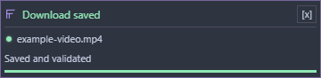
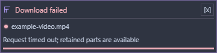

# Result notification pad — agent reference bundle

2026-11-18, Asia/Taipei. Compatible with **Fantaz Widgetz 0.1.0**. This bundle
describes the larger **360 × 88 logical-pixel** result pad used in SexBJCam Bridge
since desktop 0.10.35 and inherited by its Universal fork. It provides neutral
branding for another project to replace with its own bundled icon and palette.

The original toolkit demo still uses a **284 × 64** two-row notice. Its optional
Tauri adapter hardcodes that size. This reference adds a separate detail row;
loading this design does **not** resize that adapter or add a new adapter option.
The reference app already constructs its layout with the API; the FTZML files
here are equivalent exported designs, not files that app previously loaded.

## Files to give another project's agent

| File | Purpose |
|---|---|
| [success.ftzml](success.ftzml), [failure.ftzml](failure.ftzml) | Actual parseable/saveable FTZML v1 designs with sample literal content |
| [create-result-pad.ts](create-result-pad.ts) | The same composition using only the public Fantaz API/model |
| [host.css](host.css) | Full-window mount and transparent backing only; no element-style overrides |
| [host-contract.reference.json](host-contract.reference.json) | Native dimensions, placement, flags and lifecycle reference; not executable configuration |
| [preview.html](preview.html), [preview.ts](preview.ts) | Browser-only visual preview; no native queue or download behavior |
| [success.png](success.png), [failure.png](failure.png) | Neutral visual references rendered at 360 × 88; not interactive assets |

Copy this folder as a reference bundle. Install/pin the toolkit separately; it
is not embedded in this folder. The library source and [MIT license](../../LICENSE)
remain in the toolkit repository. For an offline consumer, build/package with
`npm run build:library` and `npm pack --workspace @fantaz/widgetz`, then pin the
archive and lockfile. The sibling repository is not required at app runtime.

## Predetermined appearance

```text
┌─────────────────────────────────────────────────────────────┐
│ icon  Download saved / Download failed                  [x] │
│ ─────────────────────────────────────────────────────────── │
│ LED   entry or output filename                             │
│ result details / saved destination / short failure reason   │
│ ━━━━━━━━━━━━━━━━━━━━━ remaining display time ━━━━━━━━━━━━━━ │
└─────────────────────────────────────────────────────────────┘
```

This is a result notice, larger than the floating speed monitor. It shares that
monitor's restrained dark purple/blue style and compact density. All visible
elements are Fantaz elements. Fixed geometry remains owned by its shipped CSS:

- One square 1 px outer frame; 4 px padding/gaps; no nested pad or native shadow.
- Fixed regular system text: normal 12 px, secondary 11 px. No font/weight API.
  Title and details use independent secondary rows and roll only on overflow.
- Bundled app icon 16 px; LED 6 px; divider 1 px; lifetime rail 3 px; fixed `[x]`.
- Quiet green `#83e6ae` for saved, red `#f1a7b3` for failed. Always show literal
  result text alongside color. Border/padding/corners remain consistent.
- Outer pad opacity **9**, meaning **88.89% opacity / 11.11% transparency**.
  Apply it once. Parent compositing also attenuates descendants; it is not a
  background-only setting. Native window, HTML and body must be transparent.
- Respect reduced motion. Retain complete accessible labels/tooltips and manual
  overflow reading. No flashing, loud glow, font changes or extra branding row.

Default palette:

| surface | text | muted | accent | border | divider |
|---|---|---|---|---|---|
| `#171b2a` | `#e7eef9` | `#b9c5d9` | `#ad94ff` | `#665691` | `#38364a` |

A host can supply its own palette and local app icon through the public API.
Do not copy the reference site's branding into an unrelated product by default.
Do not add per-consumer CSS for padding, borders, fonts or rounded corners.





## API and FTZML consumption

```ts
import {mount} from '@fantaz/widgetz';
import '@fantaz/widgetz/style.css';
import {createResultPad} from './create-result-pad';

const view = mount(document.getElementById('notice-root')!);
view.update(createResultPad({
  id: 'entry-42-saved', outcome: 'success', appName: 'Your downloader',
  title: 'example.mp4', detail: 'Saved and validated',
}, {icon: {image: './your-bundled-icon.png'}, opacity: 9}));
view.onAction(action => {
  if (action === 'dismiss') hostDismissCurrentNotice(); // host-owned effect
});
// On teardown: unsubscribe host events and call view.destroy().
```

`hostDismissCurrentNotice` is a placeholder for the consuming app's own method,
not a Fantaz export. Bundlers may emit an absolute same-origin asset URL; pass
its local pathname (or an allowed bounded raster data URL), not a remote URL.

For a saved design, read bundled XML text, then:

```ts
import {parseFTZML, saveFTZML} from '@fantaz/widgetz';
const design = parseFTZML(xmlText); // validates before replacing anything
view.load(design);
view.setText('message', entryName);
view.setText('detail', resultDetails);
view.setIcon('app-icon', {image: './your-bundled-icon.png'});
view.setProgress('lifetime', remainingMs / totalMs);
const savedXml = saveFTZML(view.design());
```

There is no interpolation engine in FTZML. Content is literal; never use raw
HTML or executable template expressions. To change all success/failure colors,
load the corresponding validated design or call `createResultPad` with the new
result. Do not assume a nonexistent `setColor` API. The lifetime bar represents
notice display time, not media download progress; native remaining time is the
authority. A host may animate the rail in the compositor between receipts.

From the toolkit checkout, `npm run dev`, then open
`http://127.0.0.1:5188/docs/notification-pad-reference/preview.html` (append
`?outcome=failure` for failure). Use a 360 × 88 viewport for exact geometry.
Preview `[x]` hides the preview only; the preview has no timer or native behavior.

## Tauri host and lifetime contract

For a downloader with an existing queue, keep it. Replace only presentation;
use `mount`/the template and keep its existing result IDs/acknowledgments. A new
app can use the optional Fantaz queue/adapter if its built-in 284 × 64 template
fits. **Do not mount this 360 × 88 design inside the unchanged 284 × 64 adapter**
or invent `Options.width/height`: those are not public options in 0.1.0.
Use an app-owned window sized for this composition, as the reference app does.

The host creates/reuses one initially hidden undecorated, nonresizable, topmost,
nonfocusable, no-taskbar transparent window without shadow. Position it at the
primary monitor's bottom-right **work area**, with a 16 logical px inset, DPI
scaling and reachability bounds. Fixed size is 360 × 88 logical px. Keep its
visibility independent of main window and floating monitor. No OS toast API.

Render, position/show successfully, then acknowledge the current notice ID and
start a native **8 s success / 12 s failure** lifetime. Hover/focus freezes the
exact remaining time; leaving resumes it. `[x]` affects only the current ID.
Stale acknowledgment/dismiss/hold messages cannot affect the next notice.
Failed native show stays retryable; use bounded retries. Avoid permanent page
polling, a timer while idle, or native calls/await while holding queue locks.
The consuming host's queue capacity, delivery watchdog and logging remain its
policy; adopting this appearance must not silently replace them.

On Windows, use `SW_SHOWNOACTIVATE`, pair native show with `SW_HIDE`, and enforce
`WS_EX_TOOLWINDOW` with `WS_EX_APPWINDOW` cleared after show as well as creation.
Tao may reapply cached styles/visibility; do not rely on stale visibility after
native show/hide. Run commands asynchronously and never call `set_focus`.
Keep platform-specific calls behind conditional compilation. Linux/macOS use
their Tauri route and require runtime verification; macOS transparency may need
a separately reviewed private API configuration. Desktop dimensions are not a
mobile touch contract: fixed touch controls are larger and need a taller layout.

Only the app confirms whether a file was validated/published or a task finally
failed. A notice or its dismissal cannot change download status, retry, navigate,
delete retained parts, or run a downloader. Show curated failure text, never
signed media URLs, credentials or raw child-process output.

## Verification and provenance

Before shipping in another project, verify both outcomes, long names/details,
opaque versus transparent desktop backing, DPI/work-area placement, uniform
frame/spacing, `[x]`, no taskbar item/focus theft, hover past expiry, resumed
expiry, queue order/stale IDs, show failures, reduced motion and teardown.
Use generated/disposable results, never mark a live entry Downloaded to test UI.

The toolkit fixes shape/spacing in [style.css](../../packages/widgetz/src/style.css),
models/API in [types.ts](../../packages/widgetz/src/types.ts) and
[templates.ts](../../packages/widgetz/src/templates.ts), FTZML in
[ftzml.ts](../../packages/widgetz/src/ftzml.ts). General docs:
[philosophy](../PHILOSOPHY.md), [API](../API.md), [integration](../INTEGRATION.md),
[FTZML](../FTZML.md), [static build/cache](../BUILD.md).

Observed consumer reference (read-only):
`C:/projs/sexbjcam_hd-downloader-lab/desktop/FANTAZ_NOTIFICATIONS.md`,
`ui/notice.ts`, `ui/notice.css`, `notice.html`, and `src-tauri/src/notices.rs`.
The consumer integration checkpoint is `15efb29` (0.10.35); the Universal fork
inherits this appearance. This reference bundle does not modify either app.
Its native behavior statements come from the existing tested implementation;
new reference screenshots/browser checks do not independently certify a new
native integration. Keep Tauri dependencies cached; no native rebuild is needed
for this documentation/template-only revision.
